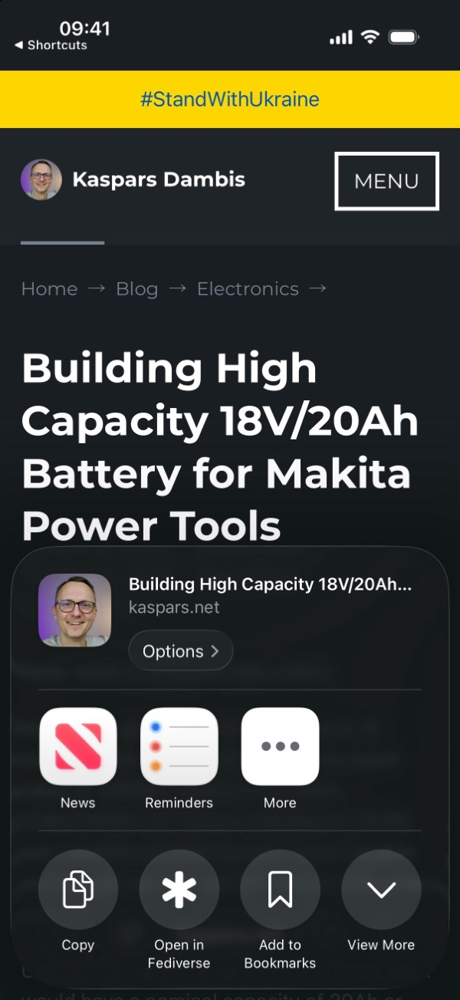
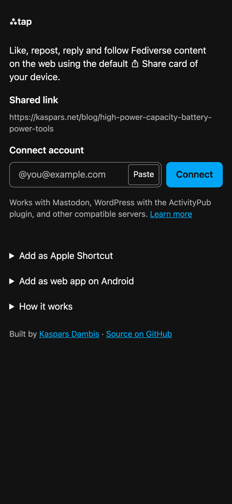
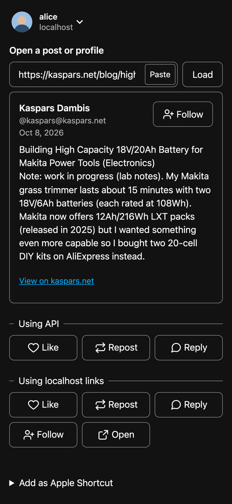
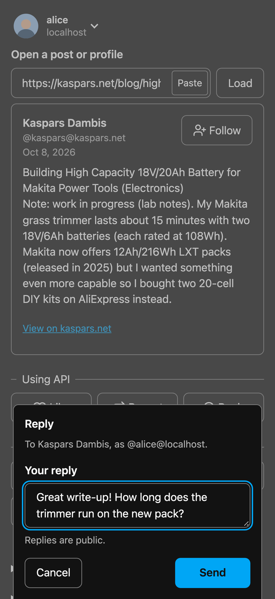
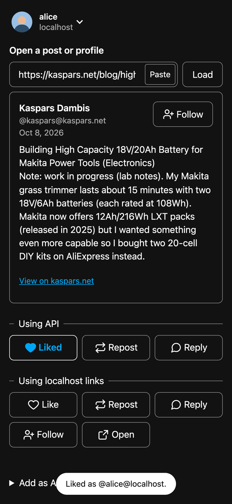
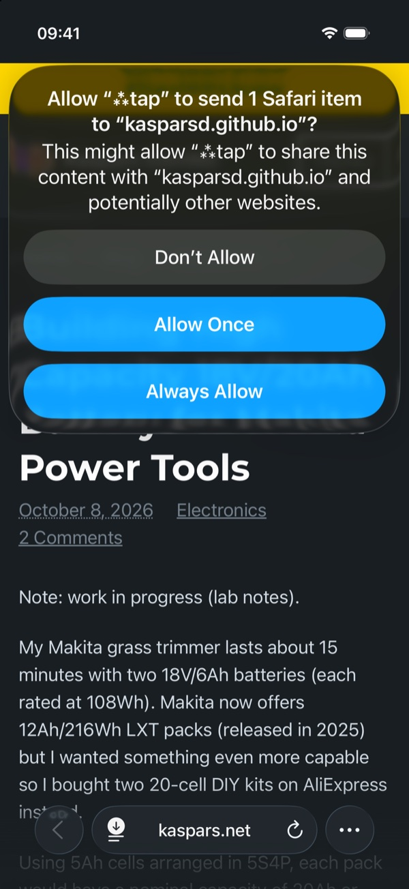

# ⁂tap

[](https://github.com/kasparsd/fedi-tap/actions/workflows/ci.yml)
[](https://github.com/kasparsd/fedi-tap/actions/workflows/pages.yml)

Like, repost, reply to or follow a Fediverse post or profile from your own account, without leaving the page you found it on.

FediTap is a small static web app. Open it in a browser, connect your account, paste a link and choose an action. On iPhone, iPad and Mac an Apple Shortcut adds FediTap to the share sheet, so sharing a link from any app opens FediTap with the link filled in.

**Use it:** <https://kasparsd.github.io/fedi-tap/>

## How it looks

Share a link from any app, choose **Open in Fediverse**, and FediTap opens with the link already loaded, ready to like, repost, reply or follow from your own account. You don't copy the link or switch apps to find the post.

| 1. Share | 2. Connect once | 3. Choose | 4. Reply | 5. Done |
|:---:|:---:|:---:|:---:|:---:|
|  |  |  |  |  |

1. In the share sheet of any app (Safari here), choose **Open in Fediverse**. To keep it in the top row, scroll the sheet to **Edit Actions** and add Open in Fediverse to Favorites.
2. The first time, connect your account. FediTap keeps the link while you approve access on your own server, then opens it.
3. The post appears with its author and four buttons, and nothing is sent until you press one.
4. Reply opens a sheet that says who it is to, which account it is from and that replies are public.
5. Each action confirms what happened and as which account.

iOS asks once whether the Shortcut may send the link to the page, and shows the page's address. Choose **Allow Once**, or **Always Allow** to stop being asked.



The screenshots are an iPhone in dark mode. The share sheet and the prompt come from the iOS Simulator with the published Shortcut, and the FediTap screens from the current page in Chromium. The account is a made-up one on the local mock server, and the shared post is a public blog post. [docs/development.md](docs/development.md#screenshots-for-the-readme) says how to repeat them.

## What it does

- **Like, Repost and Follow** are toggles. Each shows its done state (Liked, Reposted, Follow requested) and offers **Undo**.
- **Reply** opens a sheet that names the post and your account and says who can see the reply. The author is mentioned. A failed send keeps your draft.
- **Posts and profiles.** A post link shows the post with its author. A profile link offers only Follow.
- **Several accounts.** Connect as many as you like and switch with one tap on their pictures at the top. Removing an account clears it from this browser only.
- **Installable.** Add it to the Home Screen on iOS and Android. It keeps its own sign-in, separate from the browser.

## Supported servers

| Server | How FediTap connects |
|---|---|
| Mastodon, GoToSocial, Pleroma, Akkoma | Mastodon API. FediTap registers itself as an app on your server the first time you connect |
| Pixelfed | Mastodon API, best effort (like, reply and follow) |
| WordPress with the ActivityPub plugin 9.4 or later | Client-to-server ActivityPub. Enable **ActivityPub API** under **Settings › ActivityPub › Advanced** |
| Other servers with an ActivityPub client API | The [Social API Basic Profile](https://swicg.github.io/activitypub-api/basicprofile) with OAuth and PKCE |

Lemmy and Misskey use different APIs and are not supported. FediTap picks the backend itself: it looks for the ActivityPub client API first, then for a Mastodon-compatible `/api/v1/instance`.

## Connect and use

1. Open FediTap and enter your handle (`@you@example.social`) or a link to your profile. Approve access on your home server.
2. Choose **Paste** in the link field, or type a link and choose **Open**, then choose an action.
3. On iPhone, iPad or Mac, choose **Add Apple Shortcut**, open the file in Shortcuts and add it. Share a Fediverse link to **Open in Fediverse** to open the page with the link filled in.
4. On Android, install the app from your browser's menu (**Install app** or **Add to Home screen**). Then share a Fediverse link to **⁂tap** from the share sheet, and long-press the home-screen icon for **Paste a link**. Sharing works in Chrome, Edge, Brave and Samsung Internet; Firefox for Android doesn't reliably support it.

## Privacy and security

- Accounts and tokens live in your browser's local storage and are sent only to your own server. There is no FediTap backend.
- The only remote pictures the page loads are your connected accounts' own photos, from the servers that host them.
- The shortcut sends only the shared link, in the page address, and never receives credentials.
- Remote text is shown as plain text; HTML from servers is never rendered. A strict Content Security Policy forbids inline code and requires Trusted Types. The page draws nothing when another page frames it.
- Sign-in uses OAuth with PKCE and checks that the account that signs in is the one you asked for. To end access completely, also revoke FediTap in your server's settings.

## Develop

```bash
npm install
npm run dev        # https://localhost:8443/_dev/ with a mock server, no real account needed
npm run validate   # lint, svelte-check, unit tests, build and static checks
npm run e2e        # Playwright end-to-end tests (first run: npm run e2e:install)
```

The app is Svelte 5 and Vite, built to a static `dist/` and published to GitHub Pages on every push to `main`. The dev server fakes ActivityPub, Mastodon API and OAuth servers, with sample users for each failure path.

Details are in [docs/development.md](docs/development.md): hosting, backends, the mock server, testing, CORS and the shortcut build. Interface rules are in [docs/ux/components.md](docs/ux/components.md) and dated test evidence is in [docs/checkpoints/](docs/checkpoints/).
